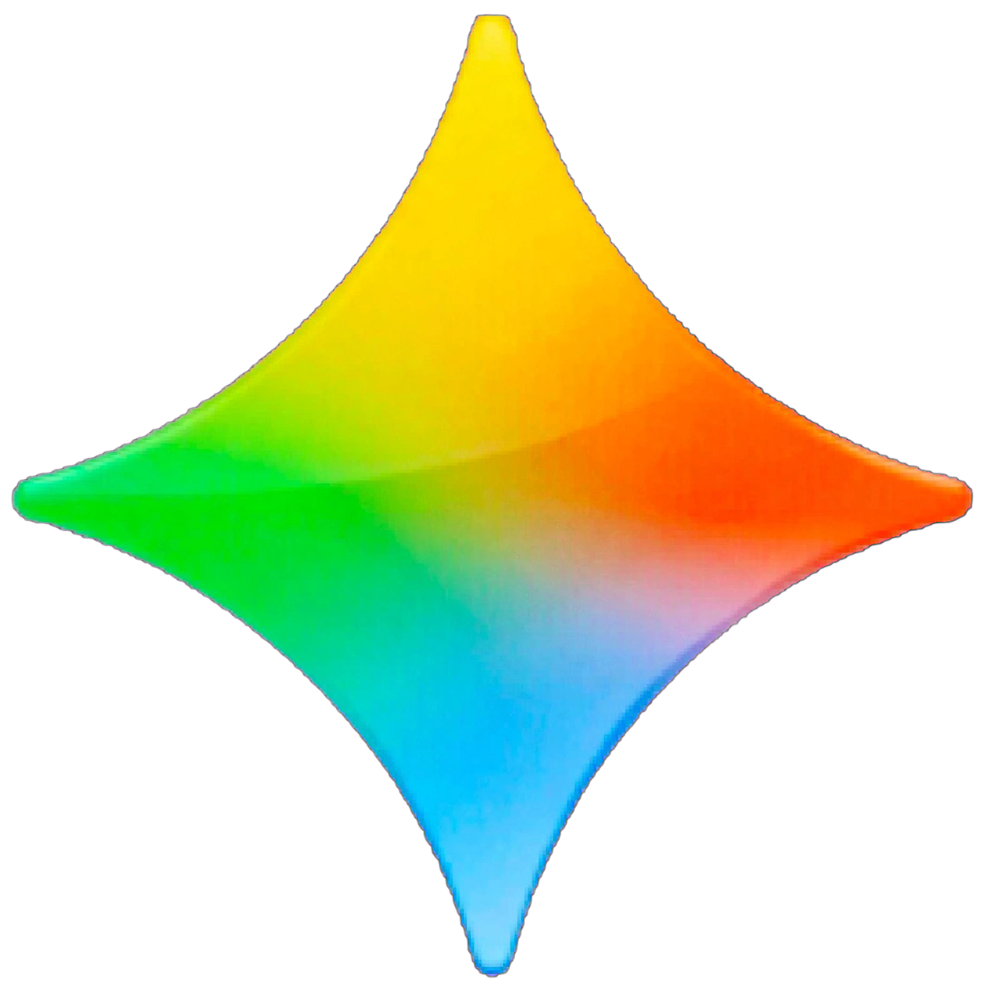

<!DOCTYPE html>
<html lang="ar" dir="rtl">
<head>
<meta charset="UTF-8">
<meta name="viewport" content="width=device-width, initial-scale=1.0">
<title>Gemalot</title>

</head>
<body>

  

  

  
كيف يمكنني مساعدتك

  
<button class="model-current" onclick="toggleModelDropdown()" id="currentModelBtn">Gemalot Normal ▼</button>

  

    <button class="menu-btn" onclick="location.href='settings.html'">⚙️</button>
    <button class="menu-btn" onclick="toggleSidebar()"></button>
  

  

    

Gemalot Normal
<small style="font-size:11px;color:#6b7280;display:block;margin-top:2px">200 رسالة - بدون Gemini - الوضع العادي</small>
✓
  

  

    

Gemalot Pro
<small style="font-size:11px;color:#6b7280;display:block;margin-top:2px">15 رسالة - الوضع العادي - Gemini</small>
✓
  

  

  

    

🔒 Gemalot Pro Plus
<small style="font-size:11px;color:#6b7280;display:block;margin-top:2px">25 رسالة + مصادر أكثر + Gemini - اشتراك</small>

  

  

    

🔒 Gemalot Pro Gold
<small style="font-size:11px;color:#6b7280;display:block;margin-top:2px">35 رسالة + فاكثر + Gemini - اشتراك</small>

  

  

    

🔒 Gemalot Pro Extra
<small style="font-size:11px;color:#6b7280;display:block;margin-top:2px">50 رسالة + حزمة كاملة + Gemini - اشتراك</small>

  

  <button class="new-chat-btn" onclick="newChat()">+ محادثة جديدة</button>
  <h3>المحادثات</h3>
  

  

    <h1>Gemalot</h1>
    

    
كيف يمكنني مساعدتك؟

  

  <button class="sug-btn" onclick="sendSuggestion('نواقض الوضوء')">نواقض الوضوء</button>
  <button class="sug-btn" onclick="sendSuggestion('أحكام الصيام')">أحكام الصيام</button>
  <button class="sug-btn" onclick="sendSuggestion('أركان الصلاة')">أركان الصلاة</button>
  <button class="sug-btn" onclick="sendSuggestion('الزكاة')">الزكاة</button>

<textarea id="userInput" placeholder="اكتب سؤالك ..." rows="1"></textarea><button class="send-btn" id="sendBtn">إرسال</button>

</body>
</html>
